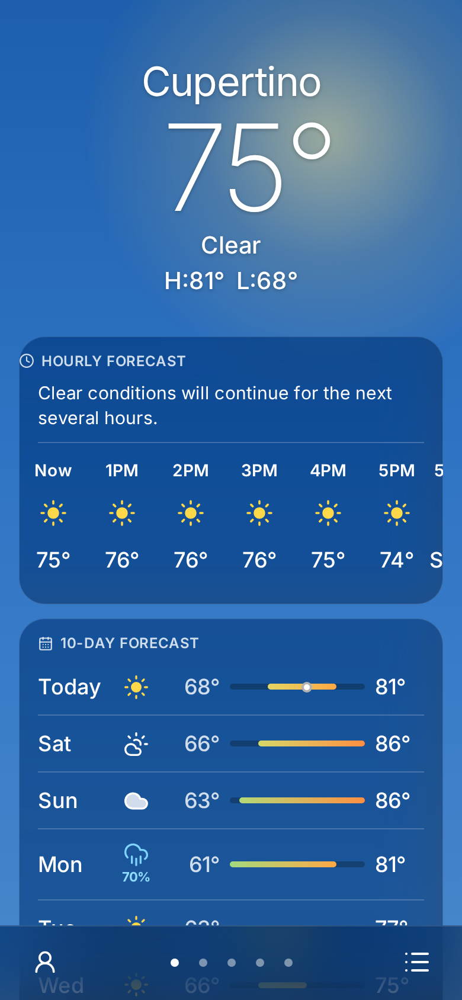
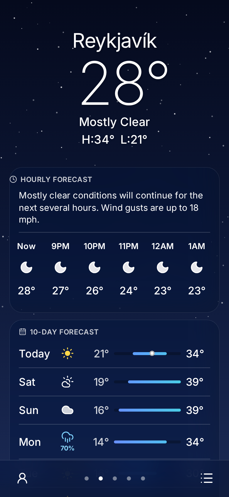
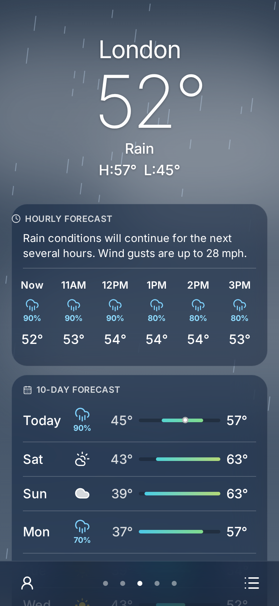
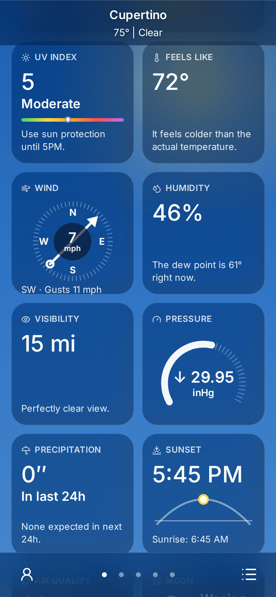
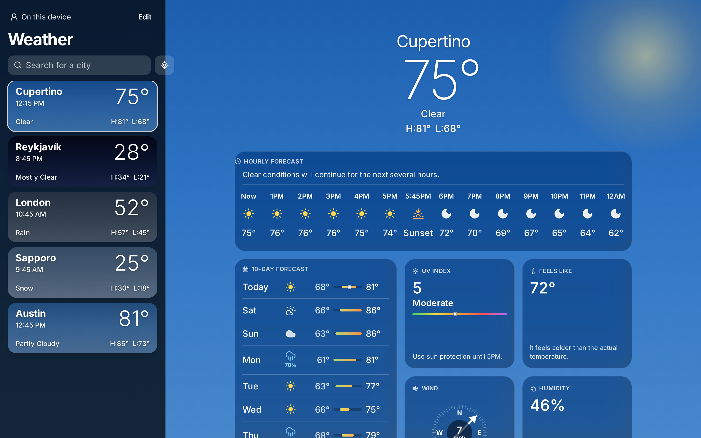
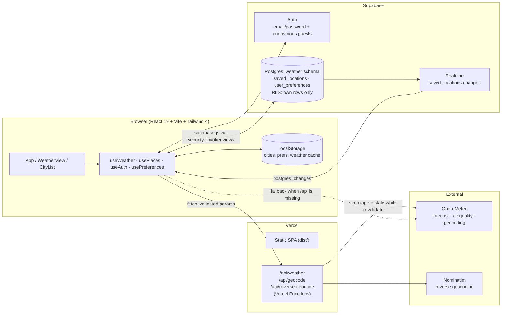

# Weather — an iPhone-style weather app for the web

**Live:** https://weather-dashboard-app-sable-three.vercel.app · **Try it signed in, no sign-up needed:** [/demo](https://weather-dashboard-app-sable-three.vercel.app/demo)

A full-stack weather app modeled on the iOS Weather app. It has animated skies that follow each city's real conditions and day/night cycle, an hourly strip with sunrise and sunset markers, a 10-day range chart, and ten detail tiles. Your city list syncs across devices in real time when you sign in. Weather data comes from [Open-Meteo](https://open-meteo.com/), so **no weather API key is needed**.

<p>
  
  
  
  
</p>


## Features

- **A living sky.** The gradient changes with the condition (clear, partly cloudy, cloudy, fog, rain, snow, storm) and with the location's own sunrise and sunset, including twilight. Canvas rain, drizzle, snow and stars, drifting clouds, a sun glow and lightning flashes all respect `prefers-reduced-motion` and pause in background tabs.
- **Hero and hourly.** Shows the current temperature, condition and high/low. A frosted 24-hour strip has inline sunrise and sunset items, precipitation chances, and a plain-language summary ("Rain likely around 2 PM…").
- **10-day forecast.** Each day has a temperature range bar colored by temperature, and today's row shows a dot for the current temperature.
- **Ten tiles.** UV index, feels like, wind compass with gusts, humidity with dew point, visibility, pressure gauge with trend, precipitation, sunrise/sunset arc, air quality (US AQI), and moon phase.
- **Notable-change banners.** Alerts for incoming thunderstorms, rain or snow starting soon, drying out, strong gusts, extreme heat or cold, and poor air quality.
- **Cities.** Geocoding autocomplete (an ARIA combobox with arrow keys, Enter and Escape), a locate-me button, a preview before adding, and reorder/delete in Edit mode. Mini cards show each city's own sky and local time. On desktop the list is a sidebar. On mobile there's a bottom bar with page dots, swipe between cities, and a full-screen list.
- **Accounts.** Sign in with email and password, or tap **Try as guest** (Supabase anonymous auth). Cities you saved while signed out merge into your account. Changes sync live across tabs and devices through Supabase Realtime. Unit preferences (°F/°C and mph, km/h, m/s or knots) and the background theme follow your account.
- **Works without an account or a backend.** Signed out, everything lives in `localStorage`. If `/api` isn't available (for example on a static host), the client calls Open-Meteo directly.
- **Polish.** Press feedback on every control (including iOS taps), mobile-first layout, WCAG 2.1 AA (axe-checked in CI), the SF Pro system font with Inter as a fallback, SEO/Open Graph/JSON-LD metadata, a web manifest and theme-color that follows the sky.

## Architecture



- **`/api` functions** (`api/*.ts`, shared code in `api/_lib`) validate inputs (coordinate ranges, query length) and return `400` JSON errors. They normalize Open-Meteo's forecast and air-quality responses into one compact payload and set CDN caching: weather `s-maxage=600, stale-while-revalidate=1800`, geocoding a day. In dev and `vite preview`, a small Vite plugin serves the same handlers, so the setup matches production. `vercel.json` rewrites only non-`/api`, non-asset paths to `index.html`.
- **Client data flow.** `useWeather` caches each city in memory and `localStorage`: cached data shows instantly, it refetches once data is 10 minutes old, and duplicate in-flight requests are shared. `usePlaces` is the single source of truth for the city list. It writes to `localStorage` while signed out and to Supabase when signed in, merges local cities into the account on sign-in, and applies Realtime events from other devices.
- **Database.** Everything lives in its own `weather` schema (it shares a Supabase project with another app). Row Level Security means every row is readable and writable only by its owner (`auth.uid() = user_id`), including anonymous guests. A trigger caps each account at 25 cities. Because a project's exposed Data API schemas are a dashboard-only setting, the client reaches the tables through two thin `security_invoker` views (`public.weather_saved_locations`, `public.weather_user_preferences`). The caller's RLS on the underlying tables still applies. See [`supabase/migrations`](supabase/migrations).

## Getting started

```bash
npm install
npm run dev        # http://localhost:5173, /api served locally
```

No API key is needed for weather. Accounts are optional: copy `.env.example` to `.env.local` and fill in your Supabase project to turn them on.

| Variable | Required | Notes |
| --- | --- | --- |
| `VITE_SUPABASE_URL` | for accounts | `https://<project-ref>.supabase.co` |
| `VITE_SUPABASE_ANON_KEY` | for accounts | Publishable (anon) key. It's public by design, and RLS protects the data. |

To set up the database, apply the SQL in `supabase/migrations/` (Supabase CLI `supabase db push`, or paste it into the SQL editor). For the guest / `/demo` flow, enable **Anonymous sign-ins** under Auth → Providers.

## Scripts

| Command | What it does |
| --- | --- |
| `npm run dev` | Vite dev server with the local `/api` |
| `npm run build` | Production build to `dist/` |
| `npm run typecheck` / `npm run lint` | TypeScript and ESLint |
| `npm test` | Playwright end-to-end tests: builds, serves `vite preview`, and mocks `/api` with deterministic fixtures |
| `SHOTS_DIR=./shots npx playwright test screenshots` | Regenerates the portfolio screenshots (mobile 390×844, desktop 1440×900) |
| `ASSETS=1 npx playwright test assets` | Regenerates `public/og.png` and `public/apple-touch-icon.png` |

The tests cover the forecast render, day/night sky selection, search → preview → add, unit switching, notable-change banners, API error recovery, `/demo`, mobile page dots and the list, reduced motion, and axe WCAG A/AA scans on four different skies. GitHub Actions (`.github/workflows/ci.yml`) runs typecheck, lint, build and the e2e suite on every push and pull request.

## Deploying

Vercel builds this with no extra configuration (`vercel.json` holds the build, rewrite and cache settings). Set the two `VITE_SUPABASE_*` variables in the project's environment variables to enable accounts. `npm run deploy` still publishes a static GitHub Pages build, which uses the direct Open-Meteo fallback.

## Credits

Weather data by [Open-Meteo](https://open-meteo.com/) (CC BY 4.0). Reverse geocoding © OpenStreetMap contributors via Nominatim. Icons by [Lucide](https://lucide.dev/).
